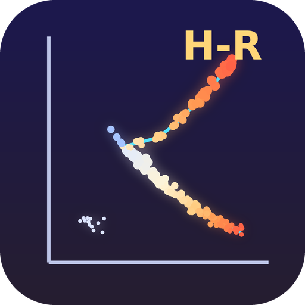

<p align="center"></p>

# HR Diagrams

*Hertzsprung–Russell diagrams of star clusters from Gaia DR3, with age, distance and metallicity from MIST isochrones* — original Italian name: «Diagrammi H-R»

Builds the colour–magnitude diagram of open and globular clusters from Gaia DR3 members, corrects for extinction, and fits MIST isochrones to estimate age, distance, reddening and metallicity. It runs as a desktop window for single clusters, or as a one-off Docker job (`nas/`) that processes about 950 clusters and writes a card for each plus a summary PDF.

## Features

* Members from VizieR catalogues (Harvard mirror), Gaia photometry, contaminated colours (C*) filtered out
* Isochrone fit with uncertainties, ages capped at 14 Gyr, *To be checked* flag for doubtful fits
* Cards always in English (PDF/PNG) and `00_summary.pdf`; adjustable text size 100–200 %
* Docker job with retries when the network drops, resumable state, low priority

## Tested on real data

Open clusters (1.3 run) compared with Cantat-Gaudin+2020: offset −0.05 dex in log age, scatter 0.19, 74 % within 0.3 dex. Globular clusters were wrong in 1.3 (crowding) and are what 1.4 fixes.

> **Language note.** The interface is in **Italian** (large, adjustable text); plots, PDF/PNG cards and scientific output are in **English**. Code comments are in Italian. The original Italian guide is [`LEGGIMI.txt`](LEGGIMI.txt).

**Version:** 1.4 (2026-11-15). **Status:** **Beta**: 1.4 not yet built; the globular-cluster fix still has to be tested.

## Quick start

Requirements: Python 3.10+ (tested with Python 3.14 on Ubuntu) with `tkinter` (Ubuntu: `sudo apt install python3-tk`) and Docker for the server part.

```bash
git clone https://github.com/EDOKILLER/hr-diagrams.git
cd hr-diagrams
python3 -m pip install -r requirements.txt

python3 diagrammi_hr.py --autotest
python3 diagrammi_hr.py --analizza "NGC 2682"   # one cluster from the terminal
python3 diagrammi_hr.py        # opens the window
```

### Standalone executable

`bash crea_eseguibile_ubuntu.sh` builds a single-file executable with PyInstaller in a temporary virtual environment, runs the self-test, and adds the program with its icon to the application menu and the desktop (first time on GNOME: right-click → *Allow launching*).

The build scripts were written for the author's machine: check the paths at the top before running them.

### Server / NAS part

The `nas/` folder runs in a `python:3.12` Docker container (tested on a UGREEN NAS with UGOS Docker, any Linux box works). Copy the files into the shared folder, edit the volume path in `nas/docker-compose.yml`, and deploy it; the container installs its libraries on first start and runs at the lowest CPU and disk priority. Step-by-step Italian instructions: `nas/LEGGIMI_NAS.txt`.

## Data sources and acknowledgements

Data are downloaded at run time from public services. If you publish results, please follow their acknowledgement policies:

* [ESA Gaia archive](https://gea.esac.esa.int/archive/)
* [VizieR catalogue service, CDS, Strasbourg (the Harvard mirror is used)](https://vizier.cds.unistra.fr/)
* [MESA Isochrones and Stellar Tracks](https://waps.cfa.harvard.edu/MIST/)
* [NASA/IPAC Infrared Science Archive: 2MASS, WISE, Spitzer, Euclid, Planck](https://irsa.ipac.caltech.edu/)

The file `openngc_compatto.csv` is a compact copy of [OpenNGC](https://github.com/mattiaverga/OpenNGC) by Mattia Verga, licensed under CC BY-SA 4.0 (see `OpenNGC_licenza_CC-BY-SA-4.0.txt`); it keeps that licence, not the BSD licence of the code.

This project is independent and not endorsed by any of these institutions.

## License

Code: [BSD 3-Clause](LICENSE) © 2026 Edoardo Battistel. You can use, modify and redistribute it, also commercially, as long as you keep the copyright notice; the author's name may not be used to promote derived works without permission. If you use it in research, see [`CITATION.cff`](CITATION.cff).

---
Part of a series of astronomy programs by Edoardo Battistel — see also [X-rays from Black Holes](https://github.com/EDOKILLER/x-rays-from-black-holes) and the other repositories on [this profile](https://github.com/EDOKILLER?tab=repositories).
